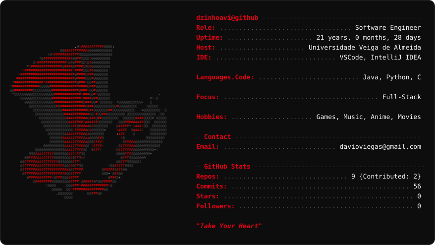

  <a href="https://github.com/dzinhoavi">
    <picture>
      <source media="(prefers-color-scheme: dark)" srcset="dark_mode.svg">
      <source media="(prefers-color-scheme: light)" srcset="light_mode.svg">
      
    </picture>
  </a>

## Hi, I'm dzinhoavi

Software Engineer focado em desenvolvimento **full-stack**, usando **Java, Python e C**. Estudante na **Universidade Veiga de Almeida**.

Fora do código: jogos, músicas, animes e filmes.

📫 **Contato:** davioviegas@gmail.com

<i>"Take Your Heart"</i>

